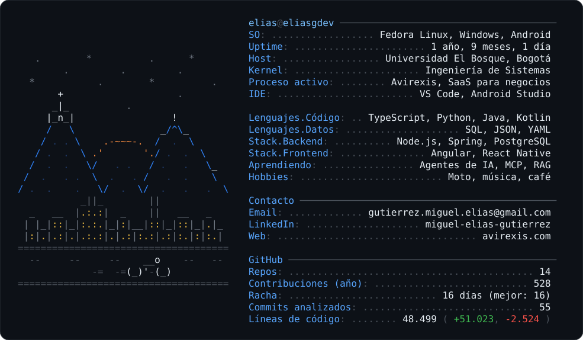
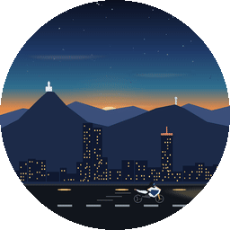

<div align="center">


<a href="https://www.linkedin.com/in/miguel-elias-gutierrez-895ab91b4"></a>
<a href="mailto:gutierrez.miguel.elias@gmail.com"></a>
<a href="https://avirexis.com"></a>
<a href="https://www.instagram.com/elias1_g27/"></a>

</div>

<picture>
  <source media="(prefers-color-scheme: dark)" srcset="assets/tarjeta-oscuro.svg" />
  <source media="(prefers-color-scheme: light)" srcset="assets/tarjeta-claro.svg" />
  
</picture>

## Sobre mí



Estudio Ingeniería de Sistemas en la Universidad El Bosque, en Bogotá, y construyo software que usan negocios reales. Me gusta el backend: diseñar la base de datos, que la API no se caiga y conectar con servicios que no tienen documentación.

<br clear="right" />

## Stack

<table>
  <tr><td><b>Lenguajes</b></td><td></td></tr>
  <tr><td><b>Backend</b></td><td></td></tr>
  <tr><td><b>Frontend y móvil</b></td><td></td></tr>
  <tr><td><b>Infraestructura</b></td><td></td></tr>
</table>

## Proyecto principal: Avirexis

> SaaS multiempresa para restaurantes, tiendas y todo tipo de negocios en Colombia, en producción en [avirexis.com](https://avirexis.com). *Código privado.*

| Módulo | Qué resuelve |
|---|---|
| **Operación** | Mesas, pedidos, caja, inventario y reportes |
| **Facturación electrónica** | XML UBL 2.1, CUFE y firma digital para la DIAN, en proceso de habilitación |
| **App móvil offline** | Los meseros siguen tomando pedidos sin internet; una cola idempotente sincroniza al volver la conexión |
| **Seguridad** | Roles por empresa, 2FA y aislamiento de datos entre clientes |

<sub>Angular · Node.js · PostgreSQL · Expo · Render · Netlify</sub>

## Otros proyectos

<div align="center">
  <a href="https://github.com/eliasgdev/turnero"></a>
  <a href="https://github.com/eliasgdev/silent-sos"></a>
  <a href="https://github.com/eliasgdev/mis-finanzas-app"></a>
  <a href="https://github.com/eliasgdev/db-unbosque-front"></a>
</div>

**También hice, con código privado:** una CLI en Python que convierte una dirección de Bogotá en su CHIP catastral y lee el estado de cuenta predial, una PWA de trabajo de campo con mapa y cola offline, y la landing de una constructora con un CMS para que el cliente la edite.

<details>
<summary><b>Mi historia en commits</b></summary>

```text
$ git log --oneline --reverse elias
a1f0c3e  init: primer "Hola mundo" en Java
b72d9e1  feat: estructuras de datos y algoritmos (ejercicios-java)
c3e81a4  feat: primeras APIs REST con Node.js, JWT y SQLite
d94b0f7  feat: proyecto de bases de datos con Angular y PostgreSQL
e5a2c18  feat: fundar Avirexis, un SaaS para negocios
f6c3d29  feat: facturación electrónica DIAN (UBL 2.1, CUFE, firma)
0a7e4b3  feat: app Android de emergencias en Kotlin (SilentSOS)
1b8f5c4  fix: dormir más (pendiente desde 2023)
2c9a6d5  feat: turnero, cola de trabajos open source sobre PostgreSQL
3d0b7e6  (HEAD -> main) wip: agentes de IA, MCP y RAG
```

</details>

## ¿Cuándo programo?

<!-- HORARIO:INICIO -->
**Programo más en la tarde, después de clase.** El día que más commits hago es el **jueves**.

```text
Madrugada (00–06)      0 commits   ░░░░░░░░░░░░░░░░░░░░░░░░░    0.0 %
Mañana (06–12)         7 commits   ███░░░░░░░░░░░░░░░░░░░░░░   10.8 %
Tarde (12–18)         30 commits   ████████████░░░░░░░░░░░░░   46.2 %
Noche (18–24)         28 commits   ███████████░░░░░░░░░░░░░░   43.1 %
```

```text
Lunes                 15 commits   ██████░░░░░░░░░░░░░░░░░░░   23.1 %
Martes                 6 commits   ██░░░░░░░░░░░░░░░░░░░░░░░    9.2 %
Miércoles              4 commits   ██░░░░░░░░░░░░░░░░░░░░░░░    6.2 %
Jueves                20 commits   ████████░░░░░░░░░░░░░░░░░   30.8 %
Viernes               20 commits   ████████░░░░░░░░░░░░░░░░░   30.8 %
Sábado                 0 commits   ░░░░░░░░░░░░░░░░░░░░░░░░░    0.0 %
Domingo                0 commits   ░░░░░░░░░░░░░░░░░░░░░░░░░    0.0 %
```

<sub>Calculado con 65 commits en hora de Bogotá · 2026-11-11</sub>
<!-- HORARIO:FIN -->

## Commit del día

<!-- DIA:INICIO -->
> **Chiste del día**<br>
> Hace tres meses: "este código se explica solo". Hoy: "¿quién escribió esto?". git blame: yo.

> **¿Sabías que...?**<br>
> El primer emoji de la historia se atribuye a Shigetaka Kurita, que en 1999 diseñó un set de 176 íconos de 12×12 píxeles.

<sub>Se actualiza solo todos los días · última actualización: 2026-11-11</sub>
<!-- DIA:FIN -->

## Actividad

<div align="center">
  
  
  <br/><br/>
  <picture>
    <source media="(prefers-color-scheme: dark)" srcset="https://raw.githubusercontent.com/eliasgdev/eliasgdev/output/snake-dark.svg" />
    
  </picture>
</div>


<div align="center"><sub>La tarjeta, el horario y el chiste se actualizan solos cada día con un GitHub Action · <a href="scripts/tarjeta.mjs">ver cómo</a></sub></div>
